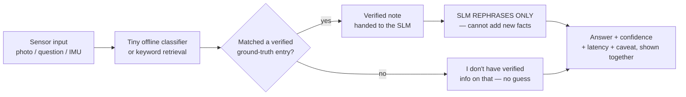
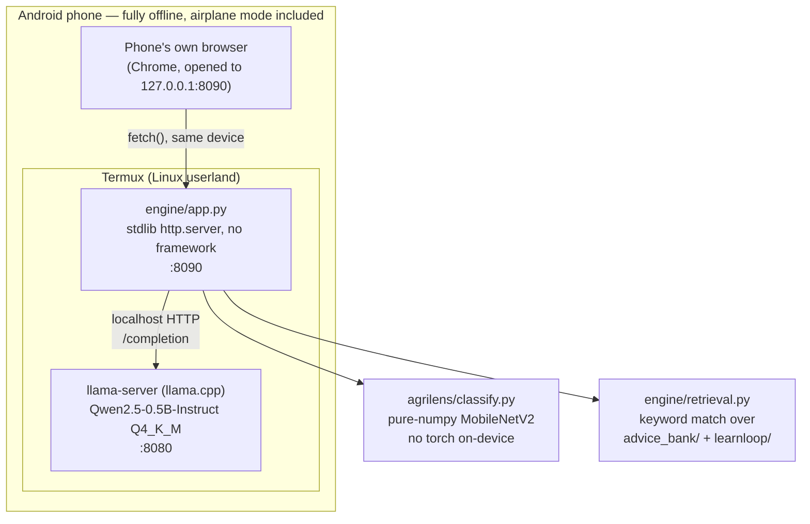

# PocketMind — Architecture

**VYOMAA LABS** · on-device AI, no cloud, no internet, measured not claimed.

Every number on this page was captured live, on a real phone, this build —
not estimated. See [`BENCHMARKS.md`](BENCHMARKS.md) for the raw runs.

## The constraint that shapes everything

A 0.5-1.5B parameter language model running on a 3.5GB-RAM Android phone
will **hallucinate** if you let it answer freely — a wrong pesticide dose
or a wrong formula is a real-world harm, not a demo quirk. So nothing here
lets a model invent a fact. Every tool follows the same shape:



The model's only job is turning a verified note into plain language. It
never gets to be the source of a fact — that's the one architectural
decision everything else serves.

## System map



Nothing in this diagram leaves the phone. The browser talks to
`127.0.0.1` — the same device, not a server anywhere else. That's the
actual claim an airplane-mode demo proves.

## Why these specific choices (and what was rejected)

| Choice | Rejected alternative | Why |
|---|---|---|
| Raw `llama-server` (llama.cpp) | Ollama | Ollama is a wrapper around the same llama.cpp engine plus an extra daemon and duplicate model-management layer — pure RAM overhead on a device with ~30-50MB truly free, for zero functional gain. |
| Raw `llama-server` | vLLM | vLLM requires a CUDA GPU. A phone has none. Not a close call. |
| Hand-rolled keyword retrieval | LangGraph / a RAG framework | The actual task is one retrieval hop → one rephrase call. A multi-step agent framework adds real dependency weight for a job that's structurally two function calls. Revisit if/when the content corpus grows enough that keyword matching stops being precise enough — not yet. |
| Qwen2.5-**0.5B**-Instruct (current default) | Qwen2.5-1.5B-Instruct (previous default) | Same architecture constraint (SLM only rephrases, never invents) means the 1.5B model's extra reasoning capacity isn't doing load-bearing work here. Measured: 0.5B answers the same grounded task in ~15s vs. 42-83s for 1.5B, with no quality loss found in side-by-side testing. See `BENCHMARKS.md`. |
| Pure-numpy MobileNetV2 forward pass | PyTorch on-device | No torch wheel story on Termux/bionic libc that doesn't risk a multi-hour from-source build. The numpy port is numerically validated against the real torch model (see `agrilens/NOTES.md`). |

## The three modules

### 1. AgriLens — crop disease, from a photo
Photo → numpy MobileNetV2 classifier → disease label → exact-match lookup
in `advice_bank/` → verified agronomy note → SLM rephrases into
farmer-plain language → answer shown with classifier confidence, timing,
and a "confirm with your KVK" caveat.

### 2. LearnLoop — Class 8-10 tutor, from a question
Question → keyword retrieval over `learnloop/content_*.md` → verified
textbook-style note → SLM rephrases, walking through any worked example →
answer shown with the matched topic, timing, and a "confirm with your
teacher" caveat.

### 3. Vehicle Risk — driving-behavior / accident-risk classifier (prototype)
Raw accelerometer + gyroscope + magnetometer stream (the same sensor class
a real ESP32 + IMU rig produces) → a tiny two-stage RandomForest (30 trees,
depth 6 each) → Stage 1 flags an elevated-risk moment, Stage 2 names the
likely behavior (sudden-brake, sudden-acceleration, sudden turn/lane
change) as the **reasoning** shown with the alert, mapped to a risk tier.
Trained on 54 real recorded trips (Kaggle harsh-driving dataset), 70%
held-out-trip accuracy on the risk flag. Honestly framed as a behavior
classifier, not a crash predictor — no public dataset pairs raw telemetry
with actual crash outcomes. Software-only today; the trees are small
enough to port to real ESP32 firmware next. See `vehicle-risk/README.md`.

## Proving it's actually offline

The browser URL is `127.0.0.1` — localhost, the phone's own loopback
interface, not a web address reachable from anywhere else. The live demo
puts the phone in **airplane mode** before running a query, and shows the
Termux terminal (server process, request log, timing) side-by-side with
the browser result, so the same two facts are visible at once: no radio
is on, and the answer still comes back.

## Repo layout

```
pocketmind/
  agrilens/            crop-disease image classifier (numpy, no torch)
  advice_bank/         verified agronomy content (tomato, maize, chilli)
  learnloop/            verified Class 8-10 study content
  engine/
    retrieval.py          keyword-match retrieval over the content banks
    llama_client.py        stdlib HTTP client for llama.cpp's native server
    app.py                  the demo web app (AgriLens + LearnLoop UI)
    setup_termux.sh          one-shot phone setup script
  vehicle-risk/          accident-risk behavior classifier (prototype)
    train.py, replay_demo.py, model/, data/, README.md
  design/
    GEMINI_GUI_PROMPT.md   self-contained prompt for redesigning the UI
  ARCHITECTURE.md        this file
  BENCHMARKS.md          real, measured on-device numbers
  README.md              quick start
```
